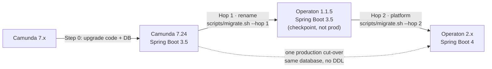

# 15 · Coming from Spring Boot 3.5: the two-hop path

This chapter is for the teams whose Camunda 7.24 application still runs on Spring Boot 3.5. Operaton 2.x needs
Spring Boot 4, so their code reaches Operaton 2.x in two code changes, called **hops**, with an Operaton 1.1.5
checkpoint in between that never goes to production. Production still switches only once. Read this chapter before
[OpenRewrite recipes](03-openrewrite-recipes.md); everything else in the guide (decisions, admin group, database,
cut-over) applies to you unchanged.

**In short**
- **You need this chapter if your application runs Camunda 7.24 on Spring Boot 3.5.** That is every Camunda 7.24.0
  CE (Community Edition) application, because CE ended at 7.24.0 and never got Spring Boot 4 support. It is also
  every Camunda EE (Enterprise Edition) application that has not moved to Spring Boot 4 yet. Teams on Spring Boot 4
  migrate in one step and do not need this chapter.
- **Hop 1 renames, Hop 2 upgrades the platform.** Hop 1 converts Camunda 7.24 to Operaton 1.1.5 and keeps Spring
  Boot 3.5. Hop 2 moves that result to Operaton 2.x and Spring Boot 4. Each hop is its own commit with its own green
  build, so you always know whether a failure comes from the rename or from the platform upgrade.
- **The 1.1.5 checkpoint never goes to production.** Operaton 1.x is end of life since 2026-07-24 and gets no
  security fixes. Production goes from Camunda 7.24 straight to Operaton 2.x, on the same database, in one cut-over.
- **`scripts/migrate.sh` detects Spring Boot 3.5 and then runs Hop 1 by default.** `--hop 2` runs Hop 2, and
  `--hop all` runs both as one combined change, which suits only small, well-tested services.
- **Hop 2 is an upgrade of your whole application from Spring Boot 3 to 4:** Jakarta EE 11, JUnit 6, Testcontainers 2,
  Liquibase 5, `@MockitoBean` instead of `@MockBean`, and Jackson 3 for your Spring code. Spin, the engine REST API
  and the external task client stay on Jackson 2, and the Hop 2 recipe keeps them there. If a blanket Jackson 3
  recipe touches Spin code, the build breaks or Spin silently loses its date handling.

## What to do

1. **Confirm that you are on this path**, so that you do not run the hops on a Spring Boot 4 project. Run
   `scripts/assess.sh`: its row *Migration path* says "Spring Boot 3.5 path". `scripts/migrate.sh` prints the same
   result in its `Source:` line. Details: [Who needs this chapter](#who-needs-this-chapter).
2. **Finish [Step 0](#step-0--camunda-724-on-spring-boot-35)**, the upgrade of code and database to Camunda 7.24,
   Java 17 and Spring Boot 3.5, and ship it as a normal Camunda release. Hop 1 relies on the Camunda 7.24
   coordinates, and Operaton uses the 7.24 database schema.
3. **Decide between two hops and one** in the
   [target-version decision (D1)](01-migration-path-and-decisions.md#d1), because one combined change is harder to
   debug. Details: [When one hop is fine](#when-one-hop-is-fine).
4. **Run Hop 1 on a clean branch**, dry run first, and commit it once its
   [exit criteria](#exit-criteria-for-hop-1) hold.
5. **Run Hop 2 on top of the committed Hop 1**, work through the [Spring Boot 4 checklist](#spring-boot-4-checklist),
   and commit it once its [exit criteria](#exit-criteria-for-hop-2) hold.
6. **Continue with the main guide from the verification step:** test on a production copy, rehearse, and cut over
   once to Operaton 2.x. Merge both hop commits before the cut-over
   ([migration checklist](../checklists/migration-checklist.md), [cut-over runbook](../checklists/cutover-runbook.md)).

The whole sequence for one service, with one commit per hop:

```bash
cd ~/src/order-service && git switch -c migration/operaton
~/migration-recipies/services/c7/scripts/migrate.sh --hop 1 --dry-run .   # review target/rewrite/rewrite.patch
~/migration-recipies/services/c7/scripts/migrate.sh --hop 1 --with-infra-env .
~/migration-recipies/services/c7/scripts/verify-leftovers.sh .              # exit 1 = must-fix leftovers
mvn -B verify && git add -A && git commit -m "Hop 1: Camunda 7.24 -> Operaton 1.1.5"
~/migration-recipies/services/c7/scripts/migrate.sh --hop 2 --target 2.1.5 .   # same routine: --dry-run first, verify-leftovers after
mvn -B verify && git add -A && git commit -m "Hop 2: Operaton 2.1.5 + Spring Boot 4"
```

## Who needs this chapter

The two-hop path exists because the official Operaton recipe and Operaton 1.x both belong to the Spring Boot 3.5
world, while every supported Operaton line (2.x) needs Spring Boot 4. Which teams are affected:

- **Camunda 7.24.0 CE.** Camunda 7 CE reached end of life with 7.24.0 (October 2025), the last CE release on Maven
  Central. It runs on Spring Boot 3.5, gets no further releases, not even security patches, and gets no Spring
  Boot 4 support. Spring Boot 3.5 itself lost open-source support on 2026-06-30. CE teams always take this path.
- **Camunda EE still on Spring Boot 3.5.** Camunda EE supports Spring Boot 4 from 7.24.3-ee on, through separate
  starters with a `-4` infix (for example `camunda-bpm-spring-boot-starter-4-webapp`). Teams that never switched to
  them are still on Spring Boot 3.5. Camunda's October 2026 environment update ends EE support for Spring Boot 3.5,
  Spring 6 and Java 11.

**EE teams have a choice.** You can move to Spring Boot 4 on Camunda first (the `-4` starters of 7.24.3-ee or
later, as a normal Camunda EE release) and then migrate in one step on the main path. Or you take the two hops
described here. `migrate.sh` names both options when you force the Spring Boot 4 path on a Spring Boot 3.5 project.
Either way, the [Camunda EE features decision (D17)](01-migration-path-and-decisions.md#d17) applies to you as well.

**How the tooling tells the paths apart.** `scripts/migrate.sh --source auto` (the default) picks the Spring Boot 4
path if the build uses Spring Boot 4 (parent `spring-boot-starter-parent`, imported `spring-boot-dependencies` or
Gradle plugin `org.springframework.boot` 4.x) or any `camunda-bpm-spring-boot-starter-4*` artifact. Otherwise it
picks the Spring Boot 3.5 path and prints:

```text
==> Source: Spring Boot 3.5 (boot3; detected: Spring Boot 3.5.5, parent spring-boot-starter-parent in pom.xml)
==> Path: two hops - this run: Hop 1 (Camunda 7.24 -> Operaton 1.1.x); then --hop 2 (Operaton 2.x + Spring Boot 4)
```

If the detection is wrong, `--source boot3` or `--source boot4` overrides it, with a warning:

```bash
scripts/migrate.sh --source boot3 --hop 1 --dry-run ~/src/legacy-service   # only if the detection is wrong
```

`scripts/assess.sh` reports the path in its *Migration path* row, recommends Operaton 1.1.5 for Hop 1 and Operaton
2.1.5 (Spring Boot 4.0) or 2.2.x (Spring Boot 4.1) for Hop 2, and suggests
`scripts/migrate.sh --hop 1 --dry-run <project-dir>` as the next step.

## The two-hop path at a glance

After Step 0, which brings code and database to Camunda 7.24, you change the **code** twice and switch
**production** only once:



The table lists the four stages. Step 0 ships a normal Camunda release. The two hops happen on a branch and are tested
against copies of the production database. Only the cut-over switches production to Operaton.

| Stage | From → to | Tool |
|---|---|---|
| Step 0 | any Camunda 7 → **Camunda 7.24**, Java 17, Spring Boot 3.5 | Camunda's upgrade scripts, [`00-preflight-checks.sql`](../sql/postgresql/00-preflight-checks.sql) |
| Hop 1 · rename | → **Operaton 1.1.5**, Spring Boot 3.5.16 (checkpoint) | `scripts/migrate.sh --hop 1` |
| Hop 2 · platform | → **Operaton 2.x**, Spring Boot 4 | `scripts/migrate.sh --hop 2 --target <v>` |
| Cut-over | production DB: Camunda 7.24 → Operaton 2.x, **same DB** | [`cutover-runbook.md`](../checklists/cutover-runbook.md) |

- **Hop 1 · rename.** `scripts/migrate.sh --hop 1` moves the code to Operaton 1.1.5. It renames Maven coordinates,
  packages, types and `camunda.bpm.*` properties, and Spring Boot 3.5 stays. The result is a **checkpoint** commit
  on a branch, never a production release, because Operaton 1.x is end of life.
- **Hop 2 · platform.** `scripts/migrate.sh --hop 2` moves the checkpoint to Operaton 2.x with Spring Boot 4, Jakarta
  EE 11, JUnit 6 and Jackson 3 for Spring (Spin stays on Jackson 2). The engine API, the database schema and the
  REST API stay the same.
- **One cut-over.** Production goes directly from Camunda 7.24 to Operaton 2.x: the Operaton 2.x application opens
  the **same** Camunda 7.24 database, without any schema change (no DDL). Operaton 1.1.5 only ever sees a copy of
  the database. How to switch: [cut-over strategy (D7)](01-migration-path-and-decisions.md#d7) and
  [Cut-over, rollback and operations](11-cutover-rollback-and-operations.md). Target the **latest 2.x patch** at
  cut-over time, and pin it.

This table shows what your build uses at each stage. Read one column per stage; bold marks the main changes.

| | Operaton 1.1.5 (after Hop 1) | Operaton 2.1.5 (after Hop 2) | Operaton 2.2.x |
|---|---|---|---|
| Role | checkpoint, never production | **Hop 2 target today** | production target once GA (due 2026-10-23) |
| Spring Boot | **3.5.16** | **4.0.8** | 4.1.x |
| Jakarta EE / JUnit Jupiter | 10 / 5.12 | **11 / 6.0.3** | 11 / 6.0.3 |
| Jackson | 2 | Spring **3**; Spin, REST 2 | same |
| Testcontainers / Liquibase | 1.21 / 4.31 | **2.0.5 / 5.0.3** | same |
| Groovy (Spring Boot managed) | 4.0.x | **5.0.x** | 5.0.x |
| FEEL `org.camunda.feel:feel-engine` | 1.19 | 1.21 | 1.22, unshaded |
| `processEngine` health | always UP | **DOWN on DB failure** | same |
| Schema log | 7.24.0 | 7.24.0 | **7.25.0** (marker row, no DDL) |
| Support | **end of life** | maintained until the 2.2 GA | preview (RC1) until GA |

Camunda 7.24.0, the baseline of Step 0, has the same Spring Boot 3.5 line, Jakarta EE, JUnit, Jackson,
Testcontainers and Liquibase versions as the 1.1.5 column. Its Java minimum is 11; Step 0 raises it to 17. What 2.0,
2.1 and 2.2 change in detail, and which 2.x line to choose:
[Operaton 2 and Spring Boot 4](12-operaton-2-and-spring-boot-4.md).

## Why two hops

Two hops keep two kinds of breakage apart. What fails after Hop 1 comes from the rename, and what fails after Hop 2
comes from the platform upgrade. Each hop is its own commit with its own green build, so a reviewer reads two
focused diffs instead of one large one.

The tools also follow this split. The official recipe (`org.operaton:migrate-camunda-recipe` 1.0.1) writes Operaton
1.0.x coordinates, a Spring Boot 3.5 line, and the pack's Hop 1 raises them to 1.1.5. No official recipe for the
step from Operaton 1.x to 2.x is released, so Hop 2 uses this pack's own recipe.

<a id="when-one-hop-is-fine"></a>

## When one hop is fine (`--hop all`)

`scripts/migrate.sh --hop all <project-dir>` runs Hop 1 and Hop 2 back to back and leaves one combined diff. It
suits small, well-tested services without custom engine plugins, Liquibase or many scripts. The
[sizing in the assessment](02-assessment.md#sizing-and-red-flags) gives the rule of thumb:

- **Small (3–8 person-days):** one service, ≤ 10 models, few scripts, ≤ 5 imports of internal `…impl…` packages, no
  plugins or exporters, and good process tests. One hop is allowed.
- **Medium (10–25 person-days):** 10–50 models, 5–30 internal-API imports, 1–2 plugins, one exporter, a config
  server. Plan two hops.
- **Large (30–80+ person-days):** 3+ services on one database, 50+ models with scripts, custom history levels or
  serializers, LDAP/SSO, or `org.camunda.*` in runtime variables. Plan two hops, a pilot and one coordinated
  cut-over.

Services that share a database take two hops each, but have **one** joint cut-over.

How `--hop all` behaves:

- With `--dry-run`, it previews only Hop 1, because Hop 2 needs the Hop 1 result. The script says so:
  `WARN: --dry-run with --hop all only previews Hop 1 (Hop 2 needs the Hop 1 result). Run Hop 2 after applying Hop 1.`
- Without `--dry-run`, it applies Hop 1, then applies Hop 2 on top of the uncommitted Hop 1 changes, and warns
  about that: `WARN: Running Hop 2 on top of the uncommitted Hop 1 changes (combined diff).` Review, build, test and
  commit the result once.

## Going live on 1.1.5

Go live on Operaton 1.1.5 only if Spring Boot 4 is impossible this year, and only with a dated exit plan. Operaton
1.1.x is end of life since 2026-07-24: 1.1.5 is its final release and receives no further updates, including
security fixes. The Operaton project tells users still on 1.1.x to plan the move to 2.1.x.

The checkpoint can also reach production by accident, when the Hop 1 commit is released instead of staying on a
branch. Treat Hop 1 as a branch state, and add a pipeline guard that rejects production releases with an Operaton
1.x dependency ([Infrastructure](11-cutover-rollback-and-operations.md#infrastructure)).

## Step 0 · Camunda 7.24 on Spring Boot 3.5

**Goal:** bring the application and its database to Camunda 7.24, Java 17 and Spring Boot 3.5, and ship that as a
normal Camunda release before any code conversion. The engine checks almost nothing at startup (only
`schema.version = 'fox'`, which every Camunda 7 database has), so Operaton also starts on an older database and
then fails at runtime with SQL errors on missing columns.

1. On Camunda 7.23 or older, run Camunda's upgrade scripts up to `*_engine_7.23_to_7.24.sql` and ship a Camunda
   7.24 release. On 7.19 or older (Spring Boot 2.7, `javax`), the move to Spring Boot 3 and Jakarta comes first:
   `org.openrewrite.java.spring.boot3.UpgradeSpringBoot_3_5` reaches Spring Boot 3.5, Java 17 and Jakarta.
2. Move to **Java 17**, the minimum for Operaton, for the build **and** the runtime.
3. Move the legacy test coordinates `org.camunda.bpm.extension:camunda-bpm-junit5` and `org.camunda.bpm.assert:*`
   to `org.camunda.bpm:camunda-bpm-junit5` / `camunda-bpm-assert`, because the recipe only maps these.
4. Run [`00-preflight-checks.sql`](../sql/postgresql/00-preflight-checks.sql), the read-only pre-flight gate. Its
   schema-level row (P01) must be OK. An overall NO_GO from the admin-group check (P03) is expected at this stage,
   because nobody is in `operaton-admin` yet.

The general Step 0 for every team, including the schema check, is in
[Migration path and decisions](01-migration-path-and-decisions.md#step-0--reach-camunda-724-first) and
[Assessment](02-assessment.md#prerequisites-step-0).

**Order of the recipe runs.** OpenRewrite also has recipes for Java and Spring Boot upgrades. Run them as separate
steps, in this order, with one commit per step, and never combine them in one run:

1. Reach Spring Boot 3.5, Java 17 and Jakarta (`org.openrewrite.java.spring.boot3.UpgradeSpringBoot_3_5`) and
   Camunda 7.24, and ship it.
2. Run Hop 1.
3. Run Hop 2.
4. Optionally run `org.openrewrite.java.migrate.UpgradeToJava21`.

## Hop 1 · Rename (Camunda 7.24 → Operaton 1.1.5)

**Goal:** turn the Camunda code into Operaton code while the platform stays the same. Hop 1 renames Maven
coordinates, packages, types, `camunda.bpm.*` keys, descriptors and ServiceLoader files. Spring Boot 3.5, Jakarta EE
10, JUnit 5 and Jackson 2 stay. The result is a checkpoint on a branch, never a production release.

```bash
scripts/migrate.sh --hop 1 --dry-run path/to/service   # review target/rewrite/rewrite.patch
scripts/migrate.sh --hop 1 --with-infra-env path/to/service   # apply, build, fix, commit
scripts/verify-leftovers.sh          path/to/service   # exit 1 on MUST-FIX leftovers
```

The dry run only writes the patch, and the size of that patch is your best estimate of the effort. `--hop 1` is the
default on this path, so `scripts/migrate.sh --dry-run path/to/service` does the same. `--with-infra-env` also renames
`CAMUNDA_BPM_*` variables in Dockerfiles, `.env`, compose and k8s/Helm YAML, and `--with-form-keys` rewrites
`camunda-forms:` keys (a rollback hard stop, see the
[Camunda Forms keys decision (D4)](01-migration-path-and-decisions.md#d4)). Both options work only in Hop 1; Hop 2
ignores them with a warning. To bypass a corporate Maven mirror, pass your own settings:
`MAVEN_ARGS="-s $HOME/.m2/central.xml" scripts/migrate.sh --hop 1 --with-infra-env ~/src/legacy-service`.

**What the recipe does.** Hop 1 runs the composite recipe `starterpack.operaton.MigrateSpringBootApp`: `PreFixes`,
then the official recipe `org.operaton.rewrite.spring.MigrateSpringBootApplication`, then `PostFixes`,
`ScriptImports` and `AlignVersions`. The first four are the same steps as on the Spring Boot 4 path and are described
in [What the composite adds](03-openrewrite-recipes.md#what-the-composite-adds). `AlignVersions` is specific to Hop 1:

- It moves every `org.operaton*` artifact to 1.1.x, because the official recipe pins the ended 1.0.x line (1.0.3).
- It aligns Spring Boot with **3.5.16**, the version Operaton 1.1.5 is built with: the parent, an imported
  `spring-boot-dependencies` and the Gradle plugin.
- It renames the property `camunda.version` to `operaton.version` (and `version.camunda` to `version.operaton`).

**Camunda EE on Spring Boot 3.5.** Hop 1 needs the Camunda EE repository and its credentials while it runs, because
the rewrite plugin resolves all dependencies before any recipe starts; `migrate.sh` prints this hint for every EE
build. The official recipe maps `camunda-bpm-spring-boot-starter-webapp-ee` and `camunda-webapp-webjar-ee` to the CE
artifacts and deletes `camunda.bpm.license-file`. The pack tests the Spring Boot 3.5 path end to end on the CE
example (CI job "Recipes end-to-end (legacy -> Hop 1 -> Hop 2)"); an EE build on Spring Boot 3.5 is not part of
these tests. Dry-run first, and check the versions in the diff: `scripts/verify-leftovers.sh` reports leftover
`-ee` versions (`EE_VERSION`) and the EE repository (`EE_REPOSITORY`).

Some tests turn red after Hop 1 on purpose; see [Tests across the two hops](#tests-across-the-two-hops).

<a id="exit-criteria-for-hop-1"></a>

**Exit criteria for Hop 1.** Hop 1 is done when all of these hold:
- The code compiles and the tests are green.
- `verify-leftovers.sh` is clean.
- The app boots against a **production DB copy** (a restored copy of the production database, never the live one)
  with the admin-group step applied. That step mirrors `camunda-admin`: it copies the group's members and
  authorizations to `operaton-admin` ([admin-group decision, D5](01-migration-path-and-decisions.md#d5)).
- [`smoke-test.sh`](../scripts/smoke-test.sh), the REST and webapp smoke test that also checks the admin setup
  page, is green.

## Hop 2 · Platform (Operaton 1.1.5 → Operaton 2.x and Spring Boot 4)

**Goal:** move to the maintained Operaton 2.x line, which requires Spring Boot 4. The engine API, the database
schema and the REST API stay the same, so this hop changes the platform around the engine. Start from the committed,
green Hop 1 on a clean branch, so that the Hop 2 diff contains only the platform change.

```bash
scripts/migrate.sh --hop 2 --target 2.1.5 --dry-run ~/src/order-service   # writes target/rewrite/rewrite.patch
scripts/migrate.sh --hop 2 --target 2.1.5 ~/src/order-service
(cd ~/src/order-service && mvn -B clean verify)
scripts/verify-leftovers.sh ~/src/order-service
```

The Hop 1 result is still on Spring Boot 3.5.16, so `migrate.sh` detects the Spring Boot 3.5 path again and accepts
`--hop 2`. After Hop 2 the project is on Spring Boot 4, so from then on `migrate.sh` detects the Spring Boot 4 path
and rejects `--hop`.

**What the recipe does.** Hop 2 runs `starterpack.operaton.UpgradeToOperaton2`, because no official 1.x → 2.x recipe
is released:

- It runs the Spring Boot 4.0 upgrade of `rewrite-spring` 6.37.0 (`UpgradeSpringBoot_4_0`), re-composed so that its
  Jackson 3 step skips every file that uses `org.operaton` types. Details:
  [Jackson 3 for Spring, Jackson 2 for Spin](#jackson-3-for-spring-jackson-2-for-spin).
- It moves every `org.operaton*` artifact to the target (2.1.x in the committed recipe file).
- It sets the Spring Boot parent to the exact version that Operaton release is built with (4.0.8 for 2.1.5).

**The target version.** `--target` (default 2.1.5) chooses the Operaton 2.x version. `migrate.sh` reads the matching
Spring Boot version from `org.operaton.bpm:operaton-root:<version>` on Maven Central and writes both into a temporary
copy of the recipe file; `--spring-boot <version>` overrides the Spring Boot version of Hop 2. Hop 2 is verified for
Operaton 2.1.x with Spring Boot 4.0. Other targets run, but `migrate.sh` prints
`WARN: Hop 2 is verified for Operaton 2.1.x / Spring Boot 4.0. For <target> (Spring Boot <version>) review the Spring Boot upgrade recipe list in rewrite.yml.`
A direct `scripts/migrate.sh --hop 2 --target 2.2.0 <project-dir>` is untested, and `2.2.0-RC1` is for rehearsals
only, never production. To reach Operaton 2.2, you can instead run the verified Hop 2 to 2.1.x and then do the minor
upgrade in [Moving from 2.1.x to 2.2.x](12-operaton-2-and-spring-boot-4.md#moving-from-21x-to-22x).

### What Hop 2 changes in your application

On Spring Boot 3 the Operaton 2.x start fails with
`could not find class [org.springframework.boot.jersey.autoconfigure.JerseyAutoConfiguration]`. There is no
compatibility layer, so Operaton 2.x and Spring Boot 4 move in one commit. The bigger part of Hop 2 is usually your
own application: Spring Boot 4 brings Spring 7, Jakarta EE 11, modular starters, Spring Security 7, Hibernate 7,
Jackson 3, JUnit 6 and Testcontainers 2, independent of Operaton. For that part, see the
[Spring Boot 4.0 migration guide](https://github.com/spring-projects/spring-boot/wiki/Spring-Boot-4.0-Migration-Guide).

### Jackson 3 for Spring, Jackson 2 for Spin

After Hop 2 your application contains two Jackson major versions in different packages: Jackson 3
(`tools.jackson`) for your Spring code, and Jackson 2 (`com.fasterxml.jackson`) for Spin, the engine REST API and
the external task client. They do not conflict, but every `ObjectMapper` in your code belongs to exactly one of them.
Which code uses which, and the rules for both: [Jackson 2 and Jackson 3](12-operaton-2-and-spring-boot-4.md#jackson-2-and-jackson-3).
What is specific to Hop 2:

- **`UpgradeToOperaton2` runs the Jackson 3 step only on files without `org.operaton` types.** The stock
  `UpgradeSpringBoot_4_0` recipe migrates Spin configurators too and breaks them. Classes that use both Spin and
  Spring's mapper: migrate their Spring side by hand, or split them.
- **Run `--hop 2` only on top of Hop 1.** The guard depends on the rename: in un-renamed code the Spin configurator
  still uses `org.camunda.spin` types, so the Jackson 3 step rewrites it to `tools.jackson` and drops its module
  registrations (such as `registerModule(new JavaTimeModule())`). `scripts/assess.sh` warns about this.
- **Compare REST response snapshots of your own endpoints.** Stored JSON variables are unaffected, because Spin keeps
  writing them with Jackson 2. Jackson 3 changed some defaults for your Spring code, though, and the compiler does
  not show the differences.

<a id="spring-boot-4-checklist"></a>

### Spring Boot 4 checklist after the recipe

These items need a human look after the Hop 2 recipe, because the recipe covers them only partly or cannot see the
files involved (for example parent POMs and Gradle catalogs):

- **`@MockBean` / `@SpyBean`:** Spring Boot 4 removed them. Use `@MockitoBean` / `@MockitoSpyBean`. Check fields in
  `@Configuration` classes and meta-annotations.
- **MockMvc:** it needs `@AutoConfigureMockMvc` and `spring-boot-starter-webmvc-test`. The recipe handles it; review
  the result.
- **Testcontainers 2:** the artifacts are now `testcontainers-postgresql` and `testcontainers-junit-jupiter`, and
  the class is `org.testcontainers.postgresql.PostgreSQLContainer`. Check parent POMs and Gradle catalogs.
- **Modular starters:** use `spring-boot-starter-kafka` (or `-flyway`, `-liquibase`) instead of the plain library.
  Check parent POMs, which the recipe cannot see. With plain `spring-kafka`, the start fails with
  `required a bean of type 'org.springframework.kafka.core.KafkaTemplate' that could not be found`.
- **Liquibase 5** is licensed under the FSL (Functional Source License), not Apache-2.0. Get it reviewed, or pin 4.x
  deliberately. The changelog fix from
  [Database: schema, data and SQL scripts](08-database-schema-data-and-sql-scripts.md#liquibase) is untested on
  Liquibase 5.
- **Spring Security 7, Hibernate 7:** review the configuration and run the security tests.
- **Custom `ELResolver`:** delete the `getFeatureDescriptors` override, because Jakarta EL 6.0 removed that method.
  Otherwise the build fails with "method does not override or implement a method from a supertype".
- **`EnvironmentPostProcessor` (`LegacyCamundaConfigGuard`):** move the interface **and** the `spring.factories` key
  from `org.springframework.boot.env.EnvironmentPostProcessor` to `org.springframework.boot.EnvironmentPostProcessor`,
  because Spring Boot 4 moved this extension point. No recipe does it. Details:
  [Spring Boot dependencies and configuration](04-spring-boot-dependencies-and-configuration.md#fail-fast-legacycamundaconfigguard).
- **Scripts and DMN:** Hop 2 brings Groovy 5 and FEEL 1.21 (1.22 with Operaton 2.2). Test every script path and
  decision table. Details: [BPMN, DMN, forms and scripts](05-bpmn-dmn-forms-and-scripts.md).
- **Health probes and database:** put `processEngine` in readiness only
  ([health probes, D13](01-migration-path-and-decisions.md#d13)), because since 2.1 it reports DOWN when the database
  fails. Bring the database to the 2.1 minimums (PostgreSQL 14, MariaDB 10.11, MySQL 8.4).

The platform changes that every Operaton 2.x team checks, whatever path it came from, are in
[Operaton 2 and Spring Boot 4](12-operaton-2-and-spring-boot-4.md#manual-checklist-after-the-recipe).

<a id="exit-criteria-for-hop-2"></a>

**Exit criteria for Hop 2.** Hop 2 is done when everything from Hop 1 holds, and in addition:
- The readiness probes follow the [health-probes decision (D13)](01-migration-path-and-decisions.md#d13).
- Spin JSON variables round-trip, that is, they are written and read back unchanged.
- If you use Liquibase, you have decided between Liquibase 5 (FSL) and a deliberately pinned 4.x.

## Tests across the two hops

Build the safety net (tests for behaviour no compiler checks) on Camunda 7.24 first, and keep the tests unchanged
through both hops, apart from imports and coordinates. Every test that turns red then points at a real change.
How to write these tests: [Testing](10-testing.md#safety-net-on-724).

**Hop 1 migrates the test stack.** `scripts/migrate.sh --hop 1` swaps the
[test dependencies](10-testing.md#test-dependencies) and renames `camunda.cfg.xml` and `camunda.bpm` test properties
(YAML **and** Java string literals). Swap community libraries by hand, because the recipe leaves them alone.

**Some tests fail on purpose after Hop 1.** The recipes leave literals such as `"camunda-admin"` and
`"org.camunda.bpm.engine."` alone, because they are often data contracts. In the migrated example, 2 of 10 tests
failed after Hop 1 on three expectations, each one right:

- **`camunda-admin` literal:** the admin group changed. Update the expectation and plan the data step (see the
  [admin-group decision, D5](01-migration-path-and-decisions.md#d5)).
- **Form key:** the expected key changed from `camunda-forms:` to `operaton-forms:`. This happens only if you ran
  `migrate.sh` with `--with-form-keys` (see the
  [Camunda Forms keys decision, D4](01-migration-path-and-decisions.md#d4)).
- **`eventClass` canary:** `Expecting actual "org.operaton.bpm.engine.impl.history.event.HistoricProcessInstanceEventEntity" to start with "org.camunda.bpm.engine."`.
  An exported payload changed. Flip the expectation only after consumers accept both prefixes (see the
  [history-exporters decision, D9](01-migration-path-and-decisions.md#d9)).

**JUnit 4.** A JUnit 4 `ProcessEngineRule` fails loudly without `operaton.cfg.xml`. Keep JUnit 4 in Hop 1, and
convert before or during Hop 2 (`org.openrewrite.java.testing.junit5.JUnit4to5Migration`), because JUnit 6
deprecates the Vintage engine that runs JUnit 4 tests. Do not combine the conversion with the rename.

**Hop 2 changes the test platform**, not the engine test API. Keep these changes in the Hop 2 commit, separate from
the rename. The table lists each change and the recipe that handles it (— means no recipe):

| Change | Spring Boot 4 / Operaton 2 | Recipe |
|---|---|---|
| JUnit | Jupiter 6; Vintage deprecated | — |
| `@MockBean`, `@SpyBean` | removed → `@MockitoBean`, `@MockitoSpyBean` | `UpgradeToOperaton2` |
| MockMvc | needs `@AutoConfigureMockMvc`, `spring-boot-starter-webmvc-test` | `UpgradeToOperaton2` (review) |
| Testcontainers | 2.0: `testcontainers-postgresql`, `org.testcontainers.postgresql.PostgreSQLContainer` | `Testcontainers2Migration` |
| Jackson | 3 for app code; Spin stays on Jackson 2 | `UpgradeToOperaton2` skips Operaton-typed code |

Write history fingerprints (golden masters) as plain text, because plain text keeps the file independent of Jackson,
which changes in Hop 2.

## Other differences between the hops

A few versions and names differ between the Spring Boot 3.5 checkpoint and Operaton 2.x. The table collects them
with the chapter that has the details:

| Topic | Hop 1 (Operaton 1.1.5, Spring Boot 3.5) | Hop 2 (Operaton 2.x, Spring Boot 4) | Details |
|---|---|---|---|
| Spring Boot parent | 3.5.16 | 4.0.8 (2.1.5) | [Spring Boot dependencies and configuration](04-spring-boot-dependencies-and-configuration.md#dependencies) |
| `EnvironmentPostProcessor` interface and `spring.factories` key | `org.springframework.boot.env.EnvironmentPostProcessor` | `org.springframework.boot.EnvironmentPostProcessor` | [Fail fast: `LegacyCamundaConfigGuard`](04-spring-boot-dependencies-and-configuration.md#fail-fast-legacycamundaconfigguard) |
| Groovy (`groovy-jsr223`, Spring Boot managed) | 4.0.x (as Camunda 7.24) | 5.0.x | [Script engines](05-bpmn-dmn-forms-and-scripts.md#script-engines) |
| FEEL engine (feel-scala) | 1.19 | 1.21 | [FEEL and DMN](05-bpmn-dmn-forms-and-scripts.md#feel-and-dmn) |
| Keycloak plugin `org.operaton.bpm.extension:operaton-keycloak` | 1.1.0 | 2.1.0 (Operaton 2.1) | [Identity providers](06-engine-plugins-and-history-exporters.md#identity-providers) |
| `--with-infra-env`, `--with-form-keys` | applied | ignored with a warning | [Run `scripts/migrate.sh`](03-openrewrite-recipes.md#run-scriptsmigratesh) |

Two of these need a test:

- **`EnvironmentPostProcessor`:** Spring Boot 3.5 **silently never loads** the Spring Boot 4 key, so keep a test that
  starts a real `SpringApplication`, like
  [`LegacyCamundaConfigGuardTest`](../examples/operaton-spring-boot-migrated/src/test/java/com/example/orders/migration/LegacyCamundaConfigGuardTest.java).
- **FEEL:** the 1.20 changes affect unary tests (`null` instead of `false`, `?` semantics). Pin decision results in
  tests before Hop 2, including null and missing inputs.

## Watch out

Each entry names the symptom you see, its cause and the fix. For errors that both paths share, search
[OpenRewrite recipes](03-openrewrite-recipes.md#troubleshooting) and
[Tips, tricks and troubleshooting](13-tips-tricks-and-troubleshooting.md).

- **Symptom:** `could not find class [org.springframework.boot.jersey.autoconfigure.JerseyAutoConfiguration]` or
  `Failed to generate bean name for imported class 'org.operaton.bpm.spring.boot.starter.rest.OperatonBpmRestJerseyAutoConfiguration'`.
  **Cause:** Operaton 2.x runs on Spring Boot 3.
  **Fix:** run Operaton 2.x only with Spring Boot 4, that is, finish Hop 2.
- **Symptom:** `incompatible types: com.fasterxml.jackson.databind.ObjectMapper cannot be converted to tools.jackson.databind.ObjectMapper`.
  **Cause:** a blanket Jackson 3 recipe hit a Spin configurator: the stock `UpgradeSpringBoot_4_0`, or `--hop 2` on
  code that Hop 1 has not renamed yet.
  **Fix:** restore the Jackson 2 version of the class, and run Hop 2 with `UpgradeToOperaton2` on top of Hop 1.
- **Symptom:** JSON variables serialize dates as numbers or arrays.
  **Cause:** a "migrated" Spin configurator lost `JavaTimeModule`.
  **Fix:** the same as above, plus a test that the configurator is active.
- **Symptom:** Hop 2: `method does not override or implement a method from a supertype` on `getFeatureDescriptors`.
  **Cause:** Jakarta EL 6.0 removed the method.
  **Fix:** delete the method.
- **Symptom:** `ERROR: --target must be an Operaton 2.x version (got '1.1.5'); Hop 1 of the Spring Boot 3.5 path always targets the final 1.1.x`.
  **Cause:** `--target` takes an Operaton 2.x version only; it sets the target of Hop 2.
  **Fix:** drop `--target` for Hop 1, which always goes to the final 1.1.x.
- **Symptom:** `WARN: --with-infra-env / --with-form-keys belong to Hop 1 and are ignored for Hop 2`.
  **Cause:** Hop 2 does not run the optional recipes behind them (`InfraEnvVars`, `FormKeys`); they belong to the
  rename in Hop 1.
  **Fix:** none for Hop 2. If you forgot them in Hop 1, the leftovers show up in `verify-leftovers.sh`.
- **Symptom:** `ERROR: --hop belongs to the Spring Boot 3.5 path (Hop 1, Hop 2). This project is on Spring Boot 4 …`.
  **Cause:** the project is already on Spring Boot 4, for example because Hop 2 was applied.
  **Fix:** on a Spring Boot 4 project, run `migrate.sh` without `--hop` (the one-step path,
  [OpenRewrite recipes](03-openrewrite-recipes.md)). Add `--source boot3` only if the detection is wrong.
- **Symptom:** the 1.1.5 checkpoint is still in production months later.
  **Cause:** the Hop 1 checkpoint was released instead of staying on a branch.
  **Fix:** treat Hop 1 as a branch state, and add a pipeline guard that rejects production releases with an
  Operaton 1.x dependency ([Infrastructure](11-cutover-rollback-and-operations.md#infrastructure)).
- **Symptom:** a Spring Boot 3.5 test passes, but the configuration guard never ran.
  **Cause:** the guard is registered under the Spring Boot 4 key, which Spring Boot 3.5 silently ignores.
  **Fix:** use the key of your Spring Boot line, and keep `LegacyCamundaConfigGuardTest`.
