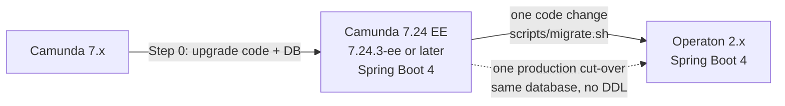

# Camunda 7 → Operaton · Migration Starter Pack

Guide and tools for Spring Boot teams that move an **embedded Camunda 7.24 engine** to **[Operaton](https://operaton.org) 2.x**.
The main path of this guide starts from **Camunda 7.24 Enterprise Edition (EE) on Spring Boot 4**: **one code change**
with `scripts/migrate.sh` and **one cut-over** in production, on the same database. It is written for developers, tech
leads, ops engineers and DBAs who know Camunda 7 but not Operaton. This page walks you through the migration in eight
steps; the [chapters of the guide](docs/README.md) hold the details.

New to the terms? [Terms used in this guide](docs/README.md#terms-used-in-this-guide) explains the cut-over, leftovers, the
admin group and the other words used here.

This pack is part of [migration-recipies](../../../README.md) and lives in its `services/c7/operaton/` folder: paths and
commands in this guide are relative to that folder, the *pack root*. The agent skill that runs these tools is in
[`plugin/`](../../../plugin/marketplace.md).

## Why

**Spring Boot 4 on Camunda 7.24 means the Enterprise Edition.** Camunda publishes its Spring Boot 4 starters only for EE,
from patch 7.24.3-ee (January 2026) on, and only in its EE repository. These starters carry a `-4` in their name, such
as `camunda-bpm-spring-boot-starter-4`. Camunda 7 EE needs a commercial license, and its 7.24 maintenance ends on
13 April 2030, so nothing forces an EE team to move before then: whether and when you leave EE is your decision, and
this guide shows what changes when you do. The Community Edition (CE) reached end of life with **7.24.0** (October
2025): no more releases, not even security patches. CE stays on Spring Boot 3.5, which lost open-source support on
2026-06-30.

Operaton is the Apache-2.0 community fork of Camunda 7. It has the same database schema, REST API and BPMN semantics, and
the Java API moved from `org.camunda` to `org.operaton`. Because the schema is identical, there is no schema migration: the
Operaton build opens your existing Camunda 7.24 database. Operaton 2.x is built on Spring Boot 4, so a Spring Boot 4
application keeps its Spring Boot line and changes in one step. Unlike Camunda 7 EE, Operaton has no long-term
support: a new minor version ships every April and October, and only the current line gets fixes, so plan for
regular upgrades ([support model decision, D14](docs/01-migration-path-and-decisions.md#d14)).

The official OpenRewrite recipe (an automated code transformation published by Operaton) does most of the renaming, but
it does not know Camunda's Spring Boot 4 starters. On a Spring Boot 4 project it leaves them in place and writes Operaton
1.0.x versions, a Spring Boot 3.5 line that is end of life, so the build breaks. It also misses several problems that
fail silently, without an error at build or start time, and one security hole. This pack closes those gaps with extra
recipes, scripts, SQL checks and a cut-over runbook. One more gap needs your configuration: Operaton lacks the security
hardening that recent EE patches added, and the tools of this pack can only report it.
[Things that bite](#things-that-bite) describes all of them.

## The path

After [Step 0](#step-by-step), which brings code and database to Camunda 7.24 EE on Spring Boot 4, you change the
**code** once and you switch **production** once.



- **One code change.** `scripts/migrate.sh` detects Spring Boot 4 and runs one recipe,
  `starterpack.operaton.MigrateSpringBoot4App`. It maps the `-4` starters to the Operaton starters (which have no `-4`),
  renames packages, types and `camunda.bpm.*` properties, and sets the Operaton version. You review the result, make
  the build green and commit it as one change. `migrate.sh` never downgrades Spring Boot; at most it raises the patch
  version to the one the target is built with.
- **The target follows your Spring Boot minor.** Operaton supports only the Spring Boot version each release is built
  with. Spring Boot 4.0 goes to **Operaton 2.1.5**; plan the move to 2.2 (which needs Spring Boot 4.1) soon after,
  because 2.1 support ends in October 2026. Spring Boot 4.1 (Camunda's default from 7.24.10-ee) goes to
  **Operaton 2.2.x**, whose GA (general availability) is due on 2026-10-23. Until then, rehearse with 2.2.0-RC1, never
  in production. No Operaton line is built with Spring Boot 4.2 yet.
- **One cut-over.** Production goes directly from Camunda 7.24 to Operaton 2.x: the Operaton app opens the **same**
  Camunda 7.24 database, without any schema change (no DDL). With Operaton 2.2.x you also run
  `<db>_engine_7.24_to_7.25.sql` at the cut-over, unless Liquibase applies it; it only writes a `7.25.0` marker row to
  the schema log.
- **Camunda EE features need a decision.** Operaton is a fork of Camunda 7 CE. The EE webapp features and the EE
  security hardening do not exist there, and Optimize does not support Operaton. That is why the
  [Camunda EE features decision (D17)](docs/01-migration-path-and-decisions.md#d17) is mandatory on this path.

> **On Spring Boot 3.5?** That is Camunda 7.24.0 CE, or EE without the `-4` starters. Operaton 2.x does not run on
> Spring Boot 3, so your code changes in two steps, and production still switches only once. Read
> [Coming from Spring Boot 3.5: the two-hop path](docs/15-coming-from-spring-boot-3.md) first.

Details: [Migration path and decisions](docs/01-migration-path-and-decisions.md).

## Step by step

The eight steps below have the same names and order as the eight phases in the
[migration checklist](checklists/migration-checklist.md) (copy it once per service to track progress) and in the
[phased plan](docs/01-migration-path-and-decisions.md#3-phased-plan) of the chapter *Migration path and decisions*:
Assess, Decide and prepare, Convert, Verify, Rehearse, Cut-over, Hypercare and Clean-up. Services that share one
database rehearse and cut over together.

> **Before you convert any code (Step 0):** your code **and** your database must be on Camunda 7.24 EE (7.24.3-ee or
> later) with the Spring Boot 4 starters and Java 17, shipped as a normal Camunda release. Step 0 is a prerequisite, not
> one of the eight steps: Step 1 checks it, and if something is missing, you finish it as part of Step 2. Camunda's EE
> patch levels do not change the database schema, so the 7.24 schema is the same for every 7.24.N-ee patch. The engine
> checks almost nothing at startup, so Operaton also starts on an older database and then fails at runtime with SQL
> errors on missing columns. How to check and upgrade: [Assessment](docs/02-assessment.md#prerequisites-step-0).

### Step 1 · Assess

**Goal:** find out how big the migration is and where it can fail silently, before you change any code. All scans in this
step are read-only.

1. Run `scripts/assess.sh` on every repository that touches the engine, including workers, shared libraries and Helm/GitOps
   repositories. It writes a report with findings on three levels: **MUST** (blocks the migration or breaks silently unless
   somebody acts), **SHOULD** (handled by the recipes but worth a review, or a decision with a safe default) and **INFO**
   (planning context such as counts and versions). The report also names the edition (CE or EE), the Spring Boot line,
   the `-4` starters and `-jackson3` artifacts it found, the migration path, the recommended Operaton target and the next
   command to run.
2. Dry-run the conversion on a clean branch with `scripts/migrate.sh --dry-run`. It changes nothing, and the size of the
   patch is your best estimate of the effort. On Spring Boot 4.1, add `--target 2.2.0-RC1` until Operaton 2.2.0 is GA,
   and `--target 2.2.0` after that.
   An EE build needs the credentials of the Camunda EE repository for this run, because the rewrite plugin resolves all
   dependencies before any recipe runs: server id `camunda-bpm-nexus-ee` in `~/.m2/settings.xml`, or
   `MAVEN_ARGS="-s <settings with the EE credentials>"`.
3. Run the two SQL scans, `00-preflight-checks.sql` and `20-find-legacy-references.sql`, on a **production copy** (a restored
   copy of the production database, never the live one). They show the schema level, the members of the admin group, the
   variables and deployed scripts that still contain `org.camunda.*`, and the stored task filters that contain
   expressions. You need that filter list before you switch such expressions off (see
   [Things that bite](#things-that-bite)). Run both with
   `psql "$DATABASE_URL" -X -v ON_ERROR_STOP=1 -f sql/postgresql/<script>.sql`; the [SQL toolkit](sql/README.md)
   explains the flags. A `NO_GO` from the pre-flight check (psql exit code 3) is normal at this stage, because nobody
   is in `operaton-admin` yet.
4. Interview ops, the DBA, security, the process owners and the consumer teams (the teams that read the events your
   engine exports) about what no scan sees: configuration outside the repository, direct SQL scripts, event consumers,
   the EE features in daily use, and who is an admin today.

```bash
git clone https://github.com/Miragon/migration-recipies.git ~/migration-recipies
~/migration-recipies/services/c7/operaton/scripts/assess.sh ~/src/order-service > assessment.md    # MUST / SHOULD / INFO findings
~/migration-recipies/services/c7/operaton/scripts/migrate.sh --dry-run ~/src/order-service          # preview only: target/rewrite/rewrite.patch (Spring Boot 4.1: add --target 2.2.0-RC1 until the 2.2.0 GA)
```

**Done when:** every service has a report, a size class and a list of red flags, every MUST finding has an owner, and the
[decision log](checklists/decision-log-template.md) is open. The size class (small, medium or large) tells you how much
effort to plan. A red flag is a finding that can on its own block a service or set its date, for example EE features in
daily use or a Liquibase-managed engine schema. How to rate both:
[Sizing and red flags](docs/02-assessment.md#sizing-and-red-flags). Details: [Assessment](docs/02-assessment.md).

### Step 2 · Decide and prepare

**Goal:** settle the open design questions before you change code, and fix everything that can already be fixed on Camunda
7.24. Every fix you ship on Camunda is one less risk on cut-over day, and it keeps the way back open.

**Make the migration decisions.** A migration involves 18 decisions (D1–D18), for example which Operaton version you target,
whether the webapps keep their `/camunda` URL, and how you would roll back. Chapter
[01 · Migration path and decisions](docs/01-migration-path-and-decisions.md#d1) recommends an option for each. Copy the
[decision log](checklists/decision-log-template.md) into your repository and record your choice, an owner and a date. Six
decisions are mandatory, because skipping them causes a security hole, data problems, a failed start or a cut-over you
cannot undo. The EE-features decision is mandatory for every team on Spring Boot 4, because they all run Camunda EE.

| Decision | The question | What goes wrong without it |
|---|---|---|
| [Admin group (D5)](docs/01-migration-path-and-decisions.md#d5) | How do your admins become members of `operaton-admin`? | With users in the engine database, nobody is an Operaton admin, so the setup page lets anyone create an admin user. |
| [Cut-over strategy (D7)](docs/01-migration-path-and-decisions.md#d7) | How do you switch production from Camunda to Operaton? | A default rolling update runs Camunda and Operaton nodes on the same database at once, and jobs run on whichever engine picks them up. |
| [Schema management (D8)](docs/01-migration-path-and-decisions.md#d8) | Who may change the database schema, and what is checked before the first start? | The engine starts on a database it does not fit and fails later at runtime. |
| [Rollback (D15)](docs/01-migration-path-and-decisions.md#d15) | Until when can you go back, and who decides? | You discover too late that Operaton already wrote data Camunda cannot read. |
| [Camunda EE features (D17)](docs/01-migration-path-and-decisions.md#d17) | Which EE features do you use, and what replaces them? | EE webapp screens disappear without a build error, the EE security hardening is gone, and EE-only engine properties stop the Operaton start. |
| [Legacy variables (D18)](docs/01-migration-path-and-decisions.md#d18) | What happens to stored variables that contain `org.camunda.*` objects? | Operaton cannot load them and the affected instances fail. |

The EE-features decision also covers Optimize, the license, the EE repository and the Jackson 3 opt-in. Operaton needs
no license: the recipe deletes `camunda.bpm.license-file`, and you remove `camunda-license.txt` and the license mounts
and secrets. Keep the license key that Camunda stored in the database for a rollback; Operaton ignores it.

**Prepare while you are still on Camunda 7.24.** If Step 1 showed that your code or database is not on Camunda 7.24
yet, finish [Step 0](docs/01-migration-path-and-decisions.md#step-0--reach-camunda-724-first) first. The following
changes work on both engines, so ship them with a normal Camunda release:

1. **Add safety-net tests** for behaviour no compiler checks: scripts in models, forms, DMN results, timers, external tasks
   and history exporters (code that publishes engine history events to other systems, such as Kafka). After the
   conversion, a red test shows you what changed. Details: [Testing](docs/10-testing.md).
2. **Make the scripts in your models package-free and deploy them.** A script that imports `org.camunda.*` classes fails on
   Operaton when a process reaches it. A package-free script references no `org.camunda.*` (or `org.operaton.*`) class, only
   process variables and the pre-bound `S(…)` function, so it runs on both engines. Deploy it with a Camunda 7.24 release and
   migrate the running instances to the new version, because running instances keep the version they started on. Do not
   rename the imports to `org.operaton.*` instead: such a script fails on Camunda 7.24, so once instances run on it after
   the cut-over, going back means restoring the backup.
   Details: [BPMN, DMN, forms and scripts](docs/05-bpmn-dmn-forms-and-scripts.md).
3. **Convert or drain the legacy variables.** Some process variables hold Java-serialized `org.camunda.*` objects or carry
   `org.camunda.*` type names. Operaton has no such classes, so it cannot load them and fails with
   `ClassNotFoundException`. Find them with `20-find-legacy-references.sql`. Then either **convert** them in a Camunda
   7.24 release (read each variable via the API and set it again as JSON, primitives or your own DTO), or **drain** them
   (let the affected instances finish on Camunda before the cut-over). Details: [Database: schema, data and SQL scripts](docs/08-database-schema-data-and-sql-scripts.md).

**Done when:** Step 0 is shipped, the decision log has a choice, an owner and a date for each decision, the safety-net
tests are green on Camunda 7.24, and the package-free scripts are deployed with their running instances migrated.

### Step 3 · Convert

**Goal:** let the recipe do the mechanical renaming in one reviewed commit, then fix by hand what no recipe reaches.
`scripts/migrate.sh` runs Operaton's official recipe plus this pack's fixes for what it misses. It works with Maven, and
partially with Gradle: on Gradle, only the detection of the Spring Boot 4 path has been tested, not a full run, and
version catalogs (`gradle/libs.versions.toml`) are never migrated (`migrate.sh` warns about them).

1. Create a clean branch. `migrate.sh` refuses to run on a dirty working tree.
2. Make the EE repository credentials available for the run, as in Step 1.
3. Preview the change with `--dry-run` and review the patch in `target/rewrite/rewrite.patch`. `migrate.sh` prints the
   Spring Boot version it detected and the path it chose. If the detection is wrong, set it with `--source boot4` or
   `--source boot3`.
4. Apply it. The default target is Operaton 2.1.5 for Spring Boot 4.0. On Spring Boot 4.1, add `--target 2.2.0` once
   2.2.0 is GA (due 2026-10-23); `--target 2.2.0-RC1` is only for rehearsals. If you convert a Spring Boot 4.1 service
   before the GA, use `--target 2.2.0-RC1` on the migration branch. The recipe writes the target into one place, the
   `operaton.version` property that `operaton-bom` uses, so after the GA you set it to `2.2.0` (and Spring Boot to
   the patch that `scripts/latest-versions.sh` pairs with it), build, test and rehearse again before production.
   If your Spring Boot minor does not match the target, `migrate.sh` leaves Spring Boot as it is and warns with the
   matching target. `--with-infra-env` also renames `CAMUNDA_BPM_*` environment variables in Dockerfiles, `.env`,
   compose files and Kubernetes/Helm YAML inside the repository.
5. Run `scripts/verify-leftovers.sh`. It finds **leftovers**: Camunda references that no recipe converted and that Operaton
   ignores or fails on, including leftover `-4` starters, `-jackson3` artifacts, `-ee` versions and EE-only settings.
   Exit code 1 means there are leftovers you must fix.
6. Build and test. Then remove the EE repository, its `<server>` credentials and its CI secrets from the Operaton
   build, because the Operaton build no longer needs them. Build once more to prove that the build resolves from Maven
   Central alone, for example with an empty settings file and a fresh local repository:
   `printf '<settings/>\n' > /tmp/central-only.xml && mvn -B -s /tmp/central-only.xml -Dmaven.repo.local=/tmp/m2-central-only clean verify`.
   Do not revoke the EE credentials yet: a rebuild or hotfix of the Camunda build you would roll back to still needs
   them until the rollback window closes (Step 8).
7. Commit the result as one change.

```bash
cd ~/src/order-service && git switch -c migration/operaton
~/migration-recipies/services/c7/operaton/scripts/migrate.sh --dry-run .          # prints the detected path; review target/rewrite/rewrite.patch
~/migration-recipies/services/c7/operaton/scripts/migrate.sh --with-infra-env .   # Spring Boot 4.0 -> Operaton 2.1.5 (Spring Boot 4.1: add --target 2.2.0 once GA)
~/migration-recipies/services/c7/operaton/scripts/verify-leftovers.sh .           # exit 1 = must-fix leftovers
mvn -B clean verify                                                 # green? then remove the EE repository and its credentials from the build
git add -A && git commit -m "Camunda 7.24 EE -> Operaton 2.1.5"
```

The Spring Boot 4 path is tested end to end against a stub of the EE repository whose artifacts delegate to the public
CE 7.24.0 jars, not against the real EE repository. Dry-run on your own build before you rely on the result.

**Then fix by hand what no recipe reaches.** Some of it lives outside the repository, and some of it the recipes cannot
convert:

- **Configuration outside the repository**, such as CI variables and the config server. Operaton silently ignores old
  `camunda.bpm.*` keys and `CAMUNDA_BPM_*` variables and falls back to its defaults.
  How: [Spring Boot dependencies and configuration](docs/04-spring-boot-dependencies-and-configuration.md).
- **Scripts that are already deployed.** A fix in the repository does not reach instances that run on an old model
  version. How: [BPMN, DMN, forms and scripts](docs/05-bpmn-dmn-forms-and-scripts.md).
- **Consumers of your exported history events.** If the payloads carry class names, consumers receive `org.operaton…`
  instead of `org.camunda…`. How: [Engine plugins and history exporters](docs/06-engine-plugins-and-history-exporters.md).
- **Code written against Jackson 3 (`tools.jackson.*`) for Spin, the engine REST API or the external task client.**
  Operaton 2.x has only Jackson 2 artifacts for these. `migrate.sh` maps the `-jackson3` artifacts back but does not
  rewrite such code, so port it to `com.fasterxml.jackson.*`. How: [Operaton 2 and Spring Boot 4](docs/12-operaton-2-and-spring-boot-4.md).
- **EE-only engine settings and calls**, such as the query expression allow-list. Remove them before the first
  Operaton start (see [Things that bite](#things-that-bite)). How: [Identity, admin group and security](docs/07-identity-admin-group-and-security.md).

**Done when:** the conversion is committed as one change, the build is green, `verify-leftovers.sh` exits 0, and the build
resolves from Maven Central without the EE repository. If you keep a leftover on purpose, accept it in
`.operaton-migration-ignore`, an allowlist file in the project root that `verify-leftovers.sh` reads, with one entry and a
reason per leftover. Details: [OpenRewrite recipes](docs/03-openrewrite-recipes.md),
[Operaton 2 and Spring Boot 4](docs/12-operaton-2-and-spring-boot-4.md).

### Step 4 · Verify

**Goal:** prove that the converted app works on real data before anyone rehearses the cut-over. Problems with data that
still says "camunda", such as the admin group, only show up on a copy of the production database.

1. Run the full test suite.
2. On a production copy, **mirror the admin group** `camunda-admin` → `operaton-admin` with
   [`10-migrate-admin-group.sql`](sql/postgresql/10-migrate-admin-group.sql): it copies the members and authorizations.
   You need it with **DB identity** (users and groups stored in the engine database). Without the mirror, nobody is an
   Operaton admin, and the Admin webapp's setup page lets anyone create an admin user without logging in. With LDAP,
   Keycloak or OAuth2, map the admin group in the identity provider instead
   ([admin-group decision, D5](docs/01-migration-path-and-decisions.md#d5)).
3. Boot the app on that copy with job execution off (`operaton.bpm.job-execution.enabled=false`) and outbound calls stubbed,
   so that the copy stays isolated from real systems.
4. Smoke-test it with `scripts/smoke-test.sh`. It includes a non-mutating check that the admin setup page is closed, and
   `--require-operaton` makes it fail if the app is not Operaton.

```bash
~/migration-recipies/services/c7/operaton/scripts/smoke-test.sh --base-url http://localhost:8080 --require-operaton   # fails if it is not Operaton
```

**Never POST to the setup endpoint on production** to test it: if the endpoint is open, the request creates an admin.

**Done when:** all tests are green, no MUST leftovers remain, all process definitions parse (the
[parse warm-up](docs/11-cutover-rollback-and-operations.md#the-cut-over-at-a-glance) requests each one), the smoke test passes including
"admin setup page closed", every EE screen you use has a tested replacement, the mitigation for the missing EE hardening
is in place, and the consumer teams have signed off on the new event payloads.
Details: [Identity, admin group and security](docs/07-identity-admin-group-and-security.md), [Testing](docs/10-testing.md).

### Step 5 · Rehearse

**Goal:** practise the cut-over and the way back until both are routine, and measure how long production will be down. On
cut-over day you then only repeat steps that already worked.

Run the [cut-over runbook](checklists/cutover-runbook.md) end to end on a **fresh** production copy, rollback included, and
time every step. Repeat until it runs clean twice. Use the same runbook for the rehearsals and for production.

**Done when:** two rehearsals ran clean, one of them with a rollback, the process owners have accepted the downtime, and the
go/no-go criteria are agreed. Details: [Cut-over, rollback and operations](docs/11-cutover-rollback-and-operations.md).

### Step 6 · Cut-over

**Goal:** switch production from Camunda to Operaton in one planned downtime, on the same database, without opening the admin
setup page to anyone. Follow the [cut-over runbook](checklists/cutover-runbook.md) in this order:

1. **Freeze deployments and block the setup path** `<app-path>/api/admin/setup/` at the ingress. `<app-path>` is your
   webapp path, e.g. `/camunda`. The runbook starts the freeze the day before (step F-01) and keeps it until the rollback
   window closes. The block stays after go-live, because setup is never legitimate on a migrated installation.
2. **Stop all Camunda nodes.** Never run a **mixed cluster**, i.e. Camunda and Operaton nodes on the same database at the
   same time: jobs run on whichever engine picks them up, and Camunda cannot run `operaton:` definitions. Kubernetes' default
   `RollingUpdate` creates exactly that, so use `Recreate` for the cut-over release.
3. **Release the job locks.** Stopped Camunda nodes keep their job locks until they expire (default 5 min). Wait, or reset
   them with every node down. The pre-flight gate in item 6 reports `NO_GO` while a job is still locked.
4. **Take a backup.** If the engine schema is managed by Liquibase, apply the rehearsed Liquibase fix next. With an
   Operaton 2.2.x target, also run `<db>_engine_7.24_to_7.25.sql` (from Operaton's release asset
   `operaton-sql-scripts-7.25.0.tar.gz`) unless Liquibase applies it: it only writes the `7.25.0` marker row.
5. **Mirror the admin group** with `10-migrate-admin-group.sql`.
6. **Pass the pre-flight gate** [`00-preflight-checks.sql`](sql/postgresql/00-preflight-checks.sql). Its read-only checks end
   in `GO`, `GO_WITH_WARNINGS` or `NO_GO` (exit 3 = `NO_GO`). Start Operaton only after `GO` or `GO_WITH_WARNINGS`,
   because the engine itself checks almost nothing at startup.
7. **Start one Operaton node** without user traffic and smoke-test it. Then decide go or no-go; on no-go, roll back
   before any traffic arrives.
8. **Scale out** and open the traffic.

**Done when:** the smoke test passes through the public URL with the setup page closed, and the first hour stays within the
agreed [rollback triggers](docs/11-cutover-rollback-and-operations.md#rollback-and-the-point-of-no-return): the measurable
conditions, agreed before cut-over day, under which you roll back. Details: [Database: schema, data and SQL scripts](docs/08-database-schema-data-and-sql-scripts.md),
[Cut-over, rollback and operations](docs/11-cutover-rollback-and-operations.md), [SQL toolkit](sql/README.md).

### Step 7 · Hypercare

**Goal:** watch production closely while you can still go back. Hypercare is the watch period right after the cut-over, for
example 72 hours.

- Every day, check incidents, failed jobs, the job backlog and the lag of your history exporters. Look out for incidents from
  scripts on old process versions.
- A rollback means redeploying the last Camunda build on the same database. It stays possible until the
  **point of no return**: the first moment Operaton has written something Camunda 7.24 cannot read or run, for example a
  model with `operaton:` attributes that has running instances. After that, going back means restoring the backup and
  losing all work since the cut-over. The **rollback window** ends at the point of no return or at the agreed time cap
  (for example 72 hours), whichever comes first. Keep deployments frozen until then, so that no new model version takes
  you past the point of no return.
- Run the [compatibility checkpoint](checklists/cutover-runbook.md#compatibility-checkpoint-c1c3) every day. Its three
  read-only queries show whether Operaton has written anything Camunda cannot run. Report the first such event to the
  person who decides on a rollback.

**Done when:** the rollback window is closed by an explicit decision, recorded with the
[rollback decision (D15)](docs/01-migration-path-and-decisions.md#d15). Details: [Cut-over, rollback and operations](docs/11-cutover-rollback-and-operations.md),
[Tips, tricks and troubleshooting](docs/13-tips-tricks-and-troubleshooting.md).

### Step 8 · Clean-up

**Goal:** remove what you kept only for the migration, in normal releases. Wait until the rollback window is closed,
because until then a rollback still needs some of these items, such as the `camunda-admin` rows.
Details: [Cut-over, rollback and operations](docs/11-cutover-rollback-and-operations.md#hypercare-and-clean-up).

1. Drop the `camunda-admin` rows (commented block at the end of `10-migrate-admin-group.sql`). Camunda needed them for a
   rollback.
2. Remove the migration helpers: `AdminGroupMigrationPlugin` first, `LegacyCamundaConfigGuard` later. Keep the setup-path block.
3. Lift the deployment freeze and set the Kubernetes strategy back to `RollingUpdate`.
4. Delete the Camunda license files and their secrets, and revoke the EE repository credentials. The Camunda build you
   would have rolled back to needed them until now; the license rows in the database can stay.
5. If you decided to, move the webapps to `/operaton` with a redirect, and convert `camunda:` → `operaton:` in your models,
   one deployment unit at a time.

## Toolbox

The tools in this pack, what each one does, and the step where you use it.

| Tool | What it does | When |
|---|---|---|
| [`scripts/assess.sh`](scripts/assess.sh) | Read-only inventory with MUST / SHOULD / INFO findings, the edition, the path and the recommended target | Step 1 |
| [`scripts/migrate.sh`](scripts/migrate.sh) | Runs the recipes: `--source auto\|boot4\|boot3` (detected by default), `--dry-run`, `--target`, `--with-infra-env`, `--with-form-keys`; `--hop 1\|2\|all` only on the Spring Boot 3.5 path | Steps 1, 3 |
| [`scripts/verify-leftovers.sh`](scripts/verify-leftovers.sh) | Finds leftovers that Operaton ignores or that fail at runtime. Exit 1 = must fix | Step 3, CI |
| [`scripts/smoke-test.sh`](scripts/smoke-test.sh) | REST and webapp smoke test with the setup-page check. `--write` runs a tiny process | Steps 4, 6 |
| [`scripts/latest-versions.sh`](scripts/latest-versions.sh) | Compares the latest versions with the pinned ones and shows the Operaton line for each Spring Boot minor | Before you start |
| [`rewrite/rewrite.yml`](rewrite/rewrite.yml) | Official recipe plus pre-fixes, gap fixes, script imports and version alignment: `MigrateSpringBoot4App` for the Spring Boot 4 path, `MigrateSpringBootApp` and `UpgradeToOperaton2` for the two hops of the Spring Boot 3.5 path | Step 3 |
| [`sql/postgresql/`](sql/README.md) | `00` GO / NO-GO gate, `10` admin-group mirror, `20` legacy references, `30`/`31` emergency retries | Steps 1, 4, 6 |
| [`AdminGroupMigrationPlugin`](examples/operaton-spring-boot-migrated/src/main/java/com/example/orders/migration/AdminGroupMigrationPlugin.java) | Mirrors the admin group on every start | Steps 3, 4 |
| [`LegacyCamundaConfigGuard`](examples/operaton-spring-boot-migrated/src/main/java/com/example/orders/migration/LegacyCamundaConfigGuard.java) | Fails the start on leftover `camunda.bpm.*` / `CAMUNDA_BPM_*` | Step 3 |
| [`LegacyWebappPathRedirectFilter`](examples/operaton-spring-boot-migrated/src/main/java/com/example/orders/migration/LegacyWebappPathRedirectFilter.java) | Redirects old `/camunda` webapp URLs after a path move | Step 8 |
| [`examples/`](examples/README.md) | Before/after app (21 hotspots) and migration report | Reference |
| [`checklists/`](checklists/) | Migration checklist, cut-over and rollback runbook, decision log | Steps 2, 5, 6 |
| [`tools/test-boot4-path.sh`](tools/test-boot4-path.sh) | End-to-end test of the Spring Boot 4 path with a stub EE repository, so it needs no EE access. Part of the CI workflow | After changing the recipes |
| [Migration skill](../../../plugin/skills/migrating-camunda7-to-operaton/SKILL.md) | Lets Claude Code or GitHub Copilot walk you through the steps assess, decide, migrate, verify and cut over | Any step |

The three migration helpers live in the [migrated example](examples/operaton-spring-boot-migrated/src/main/java/com/example/orders/migration/).
Copy the ones you need into your service.

## Things that bite

These ten problems slip past the official recipe, and most of them fail silently: the build is green and the app starts,
but something goes wrong at runtime or in another system.

1. **The admin group is not migrated.** Operaton's webapps treat only `operaton-admin` as administrators, not
   `camunda-admin`, and nothing copies the members. With users in the engine database, nobody is an admin after the first
   start, so the setup page is open to anyone. Migrate the group before the first start.
   Details: [Identity, admin group and security](docs/07-identity-admin-group-and-security.md).
2. **Operaton lacks the security hardening of the recent EE patches.** Camunda 7.24.7-ee added an allow-list for
   expressions in task queries (on by default), and 7.24.3-ee added `validateAuthResourceIdExists` and a datasource
   autocommit check. Operaton has none of them and behaves like Camunda before 7.24.7: stored task filters evaluate any
   expression, because `enableExpressionsInStoredQueries` defaults to true (Camunda security notice 157 describes
   expression injection through filters). Set the generic property `enable-expressions-in-stored-queries: false` unless
   your filters need expressions such as `${currentUser()}`, keep expressions in ad-hoc queries off, restrict who may
   create or update filters, and keep `spring.datasource.hikari.auto-commit: false`. The pre-flight check lists the stored
   filters that use expressions (P11). Details: [Identity, admin group and security](docs/07-identity-admin-group-and-security.md).
3. **EE-only artifacts and settings have no Operaton counterpart.** The `-4` starters, the `-jackson3` artifacts and
   every `7.24.N-ee` version exist only in Camunda's EE repository, and Operaton has no EE artifacts at all. The official
   recipe maps none of the `-4` starters, so its result does not build; `migrate.sh` maps them to the Operaton starters.
   The EE webapp becomes the CE webapp without a build error, so EE Cockpit features such as the heatmap or the
   migration UI disappear. EE-only engine settings break in three ways: as generic properties (`queryExpressionAllowListEnabled`,
   `allowedExpression*InQueries`, `validateAuthResourceIdExists`) they stop the engine start as unknown properties, Java
   calls such as `setQueryExpressionValidator` or `setValidateAuthResourceIdExists` do not compile, and
   `operaton.bpm.authorization.validate-auth-resource-id-exists` is ignored silently. `verify-leftovers.sh` reports all of
   them. Details: [Camunda EE features (D17)](docs/01-migration-path-and-decisions.md#d17).
4. **Old configuration is silently ignored.** Operaton reads `operaton.bpm.*`, not `camunda.bpm.*`. Leftover `camunda.bpm.*`
   properties, `CAMUNDA_BPM_*` environment variables, `management.health.camunda` and old logger names cause no error.
   Defaults take over instead, for example `schema-update: true`, the webapp path `/operaton` and no admin user. Details:
   [Spring Boot dependencies and configuration](docs/04-spring-boot-dependencies-and-configuration.md).
5. **Scripts in models fail at runtime.** A script with `org.camunda.*` imports deploys fine and fails only when a process
   reaches it. This also hits running instances on old versions, because they keep the model version they started on and need
   an instance migration. Details: [BPMN, DMN, forms and scripts](docs/05-bpmn-dmn-forms-and-scripts.md).
6. **History exporters publish too early, and their payloads change.** Exporters run inside the engine transaction, so work
   that is later rolled back has already been published. Payloads that carry class names now say `org.operaton…`, which
   breaks consumers that route or deserialize on them. Details: [Engine plugins and history exporters](docs/06-engine-plugins-and-history-exporters.md).
7. **Direct SQL on `ACT_*` tables "still works" and still corrupts state.** Raw SQL skips the `REV_` revision bump (lost
   updates), can leave jobs locked forever, leaves incidents open and writes no operation log. Use the API, or the tested
   emergency SQL when the API is down. Details: [Database: schema, data and SQL scripts](docs/08-database-schema-data-and-sql-scripts.md).
8. **The webapp path moves.** `/camunda/app` becomes `/operaton/app` unless you keep it with
   `operaton.bpm.webapp.application-path: /camunda`. Otherwise bookmarks, ingress rules and SSO redirects return 404.
   Details: [Webapps, REST API and clients](docs/09-webapps-rest-api-and-clients.md).
9. **Spin, the engine REST API and the external task client stay on Jackson 2.** Spring Boot 4 gives your own code
   Jackson 3, but Operaton 2.x ships Spin (the engine's data-format library behind `S(…)`), the REST API and the client
   for Jackson 2 only. If you opted in to Camunda's Jackson 3 artifacts (7.24.16-ee), `migrate.sh` maps them back, but
   code written against `tools.jackson.*` for them must be ported to `com.fasterxml.jackson.*` by hand. Keep Spin code
   such as a `DataFormatConfigurator` on Jackson 2, too: the plain Spring Boot 4 recipe (`UpgradeSpringBoot_4_0`) moves
   it to Jackson 3 and drops its module registrations, and the build then fails. This pack's `MigrateSpringBoot4App`
   runs no Jackson 3 step.
   Details: [Operaton 2 and Spring Boot 4](docs/12-operaton-2-and-spring-boot-4.md).
10. **Do not rename `org.camunda.feel`.** Operaton still uses the Camunda FEEL engine, so a blanket search-and-replace of
    `org.camunda` breaks FEEL. Details: [BPMN, DMN, forms and scripts](docs/05-bpmn-dmn-forms-and-scripts.md).

The complete list, with the exact error messages, is in
[Why Operaton and what changes: the things that bite](docs/00-why-operaton-and-what-changes.md#the-12-things-that-bite).

<a id="let-claude-drive"></a>

## Use it with Claude Code or GitHub Copilot

The pack includes a skill: instructions plus the scripts of this pack, packaged so that an AI coding agent can walk you
through the same steps (assess, decide, migrate, verify and cut over). It is written for Claude Code and for GitHub
Copilot with a Claude model. Claude Code, the Copilot CLI and VS Code read the plugin files of this repository, so
their install commands look alike. The Copilot instructions below follow GitHub's documentation as of 2026-10-11;
this project has not run the skill in Copilot yet.

**Before the first run (Claude Code, Copilot CLI, VS Code).** Open or start the agent in your application's repository, not in this one:
the skill converts the project it runs in. For an EE build, put the Camunda EE repository credentials into your own
`~/.m2/settings.xml` (server id `camunda-bpm-nexus-ee`) or a settings file that you name in
`MAVEN_ARGS="-s <file>"`. The skill needs them for the recipe run, but it never writes or edits credentials itself.

**Claude Code.** Install the skill as a plugin:

```bash
claude plugin marketplace add Miragon/migration-recipies
claude plugin install operaton-migration@migration-recipies
# then in Claude Code:  /operaton-migration:migrating-camunda7-to-operaton assess
```

**GitHub Copilot CLI.** The Copilot CLI reads the same plugin files:

```bash
copilot plugin marketplace add Miragon/migration-recipies
copilot plugin install operaton-migration@migration-recipies
copilot --model claude-opus-5.5        # then: /migrating-camunda7-to-operaton assess   (or ask "assess this project for Operaton")
```

**Which Claude model.** This applies to every Copilot surface. Copilot Pro has no Opus models: use Claude Sonnet 5.5
there (`--model claude-sonnet-5.5` in the CLI). Copilot Pro+, Max, Business and Enterprise also offer Claude Opus 5.5
(`claude-opus-5.5`). On Business and Enterprise plans, the organization's Copilot policy can restrict the models, so
if no Claude model is listed, ask your Copilot administrator.

**VS Code.** Install the plugin in one of three ways. Agent plugins must be enabled (setting `chat.plugins.enabled`).

1. Install it with the Copilot CLI as shown above. VS Code picks up plugins that the Copilot CLI installed.
2. Add `"chat.plugins.marketplaces": ["Miragon/migration-recipies"]` to your `settings.json`, then install
   `operaton-migration` from the Extensions view (search for `@agentPlugins`).
3. Run **Chat: Install Plugin From Source** with the repository URL.

Then, with your application's repository open, start a Copilot chat session in agent mode, pick a Claude model in
the model picker and run `/operaton-migration:migrating-camunda7-to-operaton assess`. Picking a Claude model does not
switch to VS Code's separate *Claude* session type (Anthropic's Claude Agent SDK, also billed through Copilot). That
session type reads skills from Claude Code's folders, so if you prefer it, copy the skill to `.claude/skills/` or
`~/.claude/skills/` (see *Manual copy* below).

Expect approval prompts. The agent runs the pack's scripts, Maven and git in the terminal. By default VS Code runs
common read-only commands automatically, but it asks before risky commands and before detected writes outside the
workspace, such as the skill's build logs in `/tmp/opmig-logs` and Maven's `~/.m2`. Approve them one by one, and keep
`migrate.sh`, `mvn` and `git commit` on manual approval. Builds take minutes; the skill waits for each one to finish
before it judges the result.

**Copilot cloud agent, Visual Studio and JetBrains.** Copy the skill into your application repository; these
surfaces read it from there. The GitHub CLI does that in one command (version 2.90 or later; `gh skill` is in public
preview). It puts the skill into `.agents/skills/`, which the cloud agent and Visual Studio read.

```bash
gh skill install Miragon/migration-recipies migrating-camunda7-to-operaton
```

- **Cloud agent:** it only sees what is committed, so commit the skill folder on the migration branch only. To give
  it a build environment, copy the skill's
  [`assets/copilot/copilot-setup-steps.yml`](../../../plugin/skills/migrating-camunda7-to-operaton/assets/copilot/copilot-setup-steps.yml) to
  `.github/workflows/copilot-setup-steps.yml` of your application repository and merge it into the default branch,
  because Copilot reads it only from there. It sets up JDK 21, the Maven cache and, for EE builds, the Camunda EE
  credentials. The comments in that file list the secrets and the firewall entry an EE build needs.
- **JetBrains:** agent skills are in public preview there (Settings > GitHub Copilot > Chat > Agent). Their folders
  are not documented separately; `.github/skills/` is the safe choice, so copy the skill there by hand.

A skill inside your project contains `camunda` on purpose, in its scripts, SQL and recipes. Commit it, or list it in
`.git/info/exclude`, before the recipe run, because `migrate.sh` counts untracked files as a dirty working tree and
refuses to run. Also keep it out of the recipe run and the leftover scan, otherwise `verify-leftovers.sh` reports
dozens of false MUST findings. [SKILL.md](../../../plugin/skills/migrating-camunda7-to-operaton/SKILL.md) shows the exclusion options.

**Manual copy.** The skill folder [`plugin/skills/migrating-camunda7-to-operaton/`](../../../plugin/skills/migrating-camunda7-to-operaton/) is
self-contained: copy the whole folder, not just `SKILL.md`, because the scripts and SQL files live next to it. The table
shows which folder each tool reads.

| Copy the folder into | Read by |
|---|---|
| `.claude/skills/` in your project | Claude Code, VS Code, Visual Studio, Copilot CLI, Copilot cloud agent |
| `.github/skills/` or `.agents/skills/` in your project | GitHub Copilot only (`gh skill install` uses `.agents/skills/`; add `--agent claude-code` for `.claude/skills/`) |
| `~/.claude/skills/` (personal) | Claude Code, VS Code, Visual Studio |
| `~/.copilot/skills/` or `~/.agents/skills/` (personal) | Copilot CLI (it no longer reads `~/.claude/skills/`), VS Code, Visual Studio |

What the skill does in each mode: [SKILL.md](../../../plugin/skills/migrating-camunda7-to-operaton/SKILL.md).

## Versions

The versions this pack targets. Operaton and Spring Boot move together: only the default pairs shown here are
supported.

| Component | Version | Note |
|---|---|---|
| Camunda 7.24 EE | **7.24.3-ee** or later | The starting point. Spring Boot 4.0 from 7.24.3-ee, Spring Boot 4.1 from 7.24.10-ee |
| Operaton 2.1 | **2.1.5** (Spring Boot 4.0.8) | Target for Spring Boot 4.0. Support ends in October 2026 |
| Operaton 2.2 | **2.2.0** (Spring Boot 4.1) | Target for Spring Boot 4.1. GA due 2026-10-23; until then 2.2.0-RC1 for rehearsals only |
| Camunda 7 CE | 7.24.0 | Final CE release, Spring Boot 3.5 only |
| Operaton 1.x | 1.1.5 (Spring Boot 3.5.16) | End of life. Only a checkpoint on the [Spring Boot 3.5 path](docs/15-coming-from-spring-boot-3.md) |
| Java | 17+ | |

Checked on 2026-10-11. To compare them with the latest releases, run [`scripts/latest-versions.sh`](scripts/latest-versions.sh).

## License

[Apache License 2.0](../../../LICENSE). Independent community project, not affiliated with or endorsed by Camunda Services GmbH or the
Operaton project. "Camunda" is a trademark of Camunda Services GmbH. Test everything on a copy of your data before touching production.
